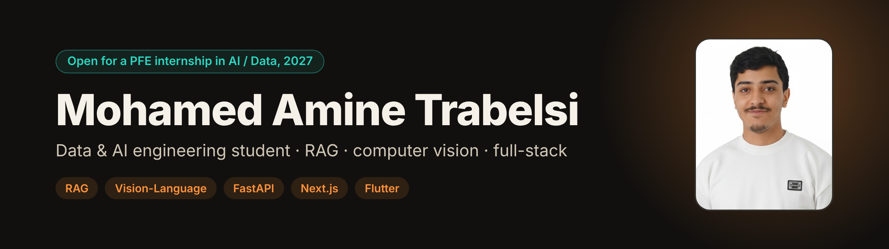

<p align="center">
  <a href="https://trabelsiamin.github.io/"></a>
</p>

<p align="center">
  <a href="https://trabelsiamin.github.io/"></a>
  <a href="https://linkedin.com/in/mohamed-amine-trabelsi-"></a>
  <a href="mailto:medaminetr30@gmail.com"></a>
  <a href="https://trabelsiamin.github.io/Trabelsi_CV_English.pdf"></a>
  <a href="https://trabelsiamin.github.io/Trabelsi_CV_Francais.pdf"></a>
</p>

---

I'm a final-year engineering student in Data & AI at the **Faculty of Sciences of Bizerte** (Tunisia). Across four internships I've built **RAG pipelines**, **vision-language and OCR systems**, and the **full-stack apps** around them, from data ingestion to deployment.

```text
> what have you been working on?
TariqMap: an offline-first road inspection app that detects potholes and cracks on the phone.
```

### What I've done recently

- **AI / RAG Engineer & Full-Stack Developer, IdeaLab** (Jun – Aug 2026)
  Built Digital Campus (FSB Nexus), an academic platform with a **provider-agnostic RAG module** over **2 LLM providers** (Mistral, Gemini fallback), PostgreSQL + pgvector and cited answers.
- **AI Engineer, Computer Vision, TechCodex** (Jun – Aug 2026)
  Fine-tuned and **4-bit quantized** a 4B-parameter vision-language model (**MedGemma 1.5 4B**) to extract data from handwritten and printed prescriptions, with human-in-the-loop validation before export.
- **AI Engineer, NLP & Computer Vision, LabelGarantie** (Jun – Aug 2025)
  OCR + LLM document-extraction pipeline (ingestion, parsing, classification, RAG) exposed through **FastAPI**.
- **Now:** building and improving **TariqMap** (since Sep 2026).

### Selected work

| Project | What it is | Stack |
| --- | --- | --- |
| **[TariqMap](https://github.com/Road-damage-project)** | Offline-first mobile app for road inspection: on-device pothole and crack detection, geolocation, resilient sync and an anomaly map | Flutter · YOLOv8 · TFLite · FastAPI · Supabase |
| **[FSB Nexus](https://github.com/AymenJeddou/digital_campus_platform)** | Multi-agent assistant for my faculty that answers from official documents and shows its sources (team project) | FastAPI · pgvector · Mistral · Next.js |
| **[FSBridge](https://github.com/AymenJeddou/FSBridge)** ([demo](https://fsbridge.vercel.app)) | Student portal: grades on the 20-point scale, timetables, signed PDFs and a Gemini assistant (team project) | React · TypeScript · Supabase · Gemini |
| **[JobJet](https://github.com/AymenJeddou/JobJet)** | Professional social network with real-time messaging, applications and automatic PDF CV generation | Node.js · Express · MongoDB · Docker |

### Toolbox


Also: Tesseract, PaddleOCR, YOLOv8, TFLite, Mistral, Gemini, SQLAlchemy, pytest, GitHub Actions, Terraform, Ansible.

5 DataCamp certifications: AI Engineer for Data Scientists, AI Engineer for Developers, Data Scientist, Data Engineer, Data Analyst.

Languages: Arabic (native), French (B2), English (B2).
